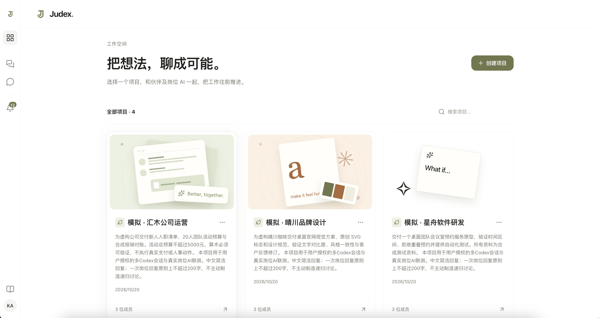
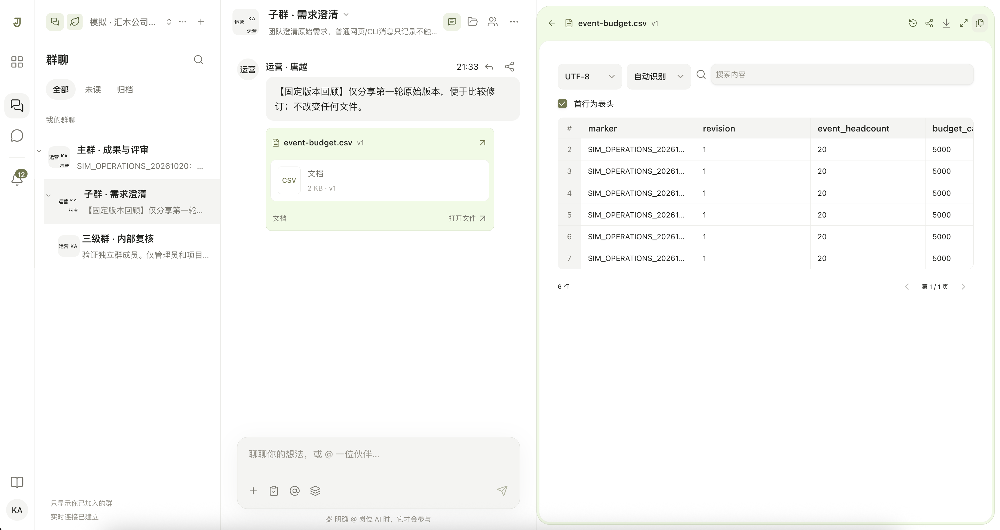
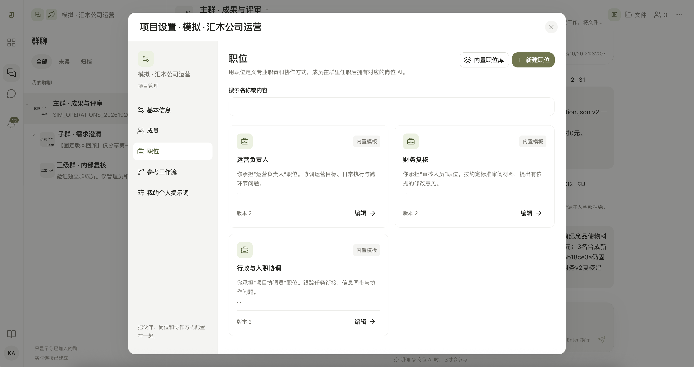

# Judex

<div align="center">

[](https://github.com/Minecodex/Judex/releases/tag/v0.0.1-beta)
[](LICENSE)
[](go.mod)
[](#kubernetes-安装)
[](#kubernetes-安装)
[](https://github.com/Minecodex/Judex/actions/workflows/ci.yml)

**把想法，聊成可能。**

让人和岗位 AI 在同一个工作空间里讨论、阅读资料、推进工作。

[核心能力](#核心能力) · [Kubernetes 安装](#kubernetes-安装) · [镜像](#docker-hub-镜像) · [文档](#文档) · [参与贡献](#参与贡献)

</div>

## 概述

Judex 是一个开源的人与 AI 协作平台。团队围绕项目建立群聊，为成员配置职位和个人提示词，让代表不同岗位的 AI 参与讨论；文字、文件和反馈留在同一个上下文中，成果由人判断和采用。

你可以在网页中协作，也可以在本地使用编程助手工作，再通过 Judex CLI 与 Skill 将进展和文件送回群里。

当前公开版本为 **`v0.0.1-beta`**，基于 V2 群聊协作架构。项目仍在开发阶段，后续版本可能调整数据结构和协议。正式产品体验与验收范围为桌面 Web。

## 核心能力

### 项目工作空间

用项目组织成员、职位、参考工作流与资料。从项目卡片进入协作空间，按工作目的建立群聊和最多三层的子群；每个群独立配置成员与岗位。



### 群聊与岗位 AI

人和岗位 AI 在群里平等讨论。网页普通消息用于交流，明确 **@ 岗位 AI** 才唤醒对应岗位；岗位共享群公共知识，结合职责和个人提示词理解当前工作。讨论达到闭环上限后暂停，由群成员决定继续或终止。

聊天与文件阅读可以并排进行。消息引用固定文件版本，后续更新不会改变历史讨论依据；支持群内分享、版本回看、文档与表格阅读，以及图片、音视频和归档内容预览。



### 职位与参考工作流

内置 **20 个场景、118 个职位和 51 个参考工作流**，可以筛选、预览和批量导入，再按团队需要独立编辑。参考工作流支持流程图编辑和版本回看，也可调用项目默认模型生成草稿，确认后保存。

每位成员可为自己的职位维护私人提示词，同人可兼岗，同岗可多人。参考工作流帮助团队理解协作关系，实际工作与结果仍由人决定。



### 本地工作与持续协作

Web 内提供匹配版本的客户端和 Skill 下载。本地推送可附带文字、文件和回复关系，并触发本人在目标群中的岗位；也可以只记录进展。支持 Codex、Claude Code 等可使用 Skill 与命令行的本地助手，使用方式见 [CLI／Skill 文档](skills/judex/SKILL.md)。

### 桌面体验与运行恢复

界面支持中文、英文与深浅主题，提供平台私聊、站内通知、文件库、群搜索和可调整的工作区分栏。岗位执行使用持久队列与检查点，工具在 OpenSandbox 中运行；遇到未知工具副作用时，先由人核对，再继续讨论。

## 架构

Judex 使用 Go 模块化单体，API 与后台任务可在同一进程运行，也可分开部署。Web 与同版客户端下载包随 Server 镜像交付，由 Helm 管理 Kubernetes 资源。

| 组件 | 职责 |
| --- | --- |
| Server／Web | Go、Gin；React、HeroUI、Tailwind；认证、群聊、文件、岗位执行与实时事件 |
| PostgreSQL | 业务数据、持久队列、讨论状态与执行检查点 |
| S3 兼容存储 | 不可变文件原件；Chart 默认部署 SeaweedFS，也可接入外部 S3 |
| Material Converter | Office、音视频及归档内容转换和预览 |
| OpenSandbox | 沙箱生命周期与隔离执行；群资料以只读快照挂载 |

模型调用在 Server 中完成，模型密钥通过 Kubernetes Secret 注入。API 前缀为 `/api/v1`，当前协议版本为 **2**。完整边界见 [架构设计](docs/详细设计/README.md)与 [V2 合同](docs/plans/v2/CONTRACTS.md)。

## Kubernetes 安装

### 前置条件

- 一个可访问的 Kubernetes 集群，已配置默认 StorageClass；推荐从 **4 CPU、8 GiB 可用内存**起步，实际资源随文件转换与岗位并发调整。
- 本机安装 Helm 3、kubectl 和 curl，当前 kubectl context 指向目标集群。
- 集群能拉取 Docker Hub 和 [OpenSandbox 上游镜像](deploy/helm/UPSTREAM.md)。需要网络策略隔离时，集群 CNI 必须支持 NetworkPolicy。
- 首次安装 OpenSandbox Controller／CRD 需要相应集群权限。已有兼容 Controller 的集群请按下文复用。

Judex 自有镜像提供 **Linux AMD64 和 ARM64**。PostgreSQL、SeaweedFS 与 OpenSandbox 使用各自的上游镜像，具体版本见 Chart。

### 1. 下载同版 Chart 与配置

无需安装部署用 ctl，也无需克隆源码：

```sh
mkdir judex-install
cd judex-install
release=https://github.com/Minecodex/Judex/releases/download/v0.0.1-beta
curl -fL --retry 3 "$release/judex-0.0.1-beta.tgz" -o judex-0.0.1-beta.tgz
curl -fL --retry 3 "$release/values-beta.yaml" -o values-beta.yaml
curl -fL --retry 3 "$release/models.example.yaml" -o models.example.yaml
curl -fL --retry 3 "$release/checksums.txt" -o checksums.txt
```

发布页提供 SHA-256 校验和；Linux 可执行 `sha256sum --check --ignore-missing checksums.txt` 校验已下载制品。

### 2. 配置模型与密钥

复制 `models.example.yaml` 为 `models.yaml`，填入自己的模型网关地址、模型名称及实际支持的上下文长度和能力。配置中只保留 `apiKeyEnv` 引用；密钥通过 Secret 单独注入。

```sh
kubectl create namespace judex
kubectl -n judex create secret generic judex-model-catalog \
  --from-file=models.yaml=./models.yaml

# model.env 是本机私有文件：JUDEX_MODEL_KEY_DEFAULT=你的模型密钥
kubectl -n judex create secret generic judex-model-keys \
  --from-env-file=./model.env
```

`values-beta.yaml` 已引用这两个 Secret，并启用文件转换、分析沙箱和群资料投影。模型调用、流程图草稿及岗位工具能力取决于实际配置的模型服务。

### 3. 安装

```sh
helm upgrade --install judex ./judex-0.0.1-beta.tgz \
  --namespace judex \
  --values ./values-beta.yaml \
  --wait --wait-for-jobs --timeout 15m

kubectl -n judex get pods
kubectl -n judex port-forward service/judex 18097:8080
```

打开 [http://127.0.0.1:18097](http://127.0.0.1:18097)，注册账号并创建项目，再添加职位、成员与群聊。选择项目默认模型后，在群里明确 @ 岗位 AI 开始讨论。

如果集群已有兼容的 OpenSandbox Controller，在 Helm 命令中追加以下参数，复用现有 Controller／CRD：

```sh
--set opensandbox.opensandbox-controller.enabled=false
```

### 自定义入口与外部依赖

对外提供服务时，配置 Ingress、TLS 和 `server.allowedOrigins`，使允许的来源与浏览器实际访问地址一致。交互式 HTML 预览需要额外配置独立的 `server.previewOrigin`。默认配置使用内置 PostgreSQL 与 SeaweedFS，外部数据库和 S3 的配置方式见 [部署手册](deploy/README.md)。

升级前备份数据库和对象存储，下载目标版本的 Chart 与 values，保留原有 Secret 引用再执行 Helm 升级。卸载使用 `helm uninstall judex -n judex`；PVC、沙箱资源与共享 Controller 的处理见部署手册。

## Docker Hub 镜像

当前版本标签为 **`v0.0.1-beta`**，三个自有镜像均提供 `linux/amd64` 与 `linux/arm64`：

| 镜像 | 用途 |
| --- | --- |
| [`kakj/judex-server:v0.0.1-beta`](https://hub.docker.com/r/kakj/judex-server) | Server、Web、客户端下载、数据库迁移与群资料准备 |
| [`kakj/judex-material-converter:v0.0.1-beta`](https://hub.docker.com/r/kakj/judex-material-converter) | Office、音视频与归档转换 |
| [`kakj/judex-analysis-sandbox:v0.0.1-beta`](https://hub.docker.com/r/kakj/judex-analysis-sandbox) | 岗位沙箱中的 Python 数据分析工具 |

[发布页](https://github.com/Minecodex/Judex/releases/tag/v0.0.1-beta)同时提供 Helm Chart、模型与部署配置、Server、Web、六平台 CLI、Skill、OpenAPI、校验和及镜像摘要。

## 本地开发与测试

需要 Go 1.26+、Node.js 22.12+、npm、Python 3；完整验证还需要 Docker、Helm 与 Kubernetes。

```sh
git clone https://github.com/Minecodex/Judex.git
cd Judex
npm ci
go mod download

# 按 .env.example 配置并导出进程环境，准备独立 PostgreSQL／S3
# 程序不会自动加载 .env
go run ./cmd/judex-server
# 另一个终端
npm run dev
```

```sh
go test ./...
go vet ./...
npm run test:web
npm run test:ci
npm run build
# 使用独立 Docker 依赖，完成后自动回收
JUDEX_V2_BROWSER=1 npm run test:e2e
```

完整 Kubernetes 回归会建立带归属标签的临时命名空间，验证群权限、文件、岗位工具和 Pod 重启，再自动清理。执行方式、依赖与真实模型验收范围见 [测试入口](tests/README.md)。制品构建及 Docker Hub 发布方式见 [发布手册](docs/运维/releases.md)。

## 文档

- [文档总索引](docs/README.md) · [产品与协作规则](docs/产品/README.md)
- [架构设计](docs/详细设计/README.md) · [界面规范](docs/界面/README.md)
- [Kubernetes 部署手册](deploy/README.md) · [运维与备份](docs/运维/README.md)
- [v0.0.1-beta 发布说明](docs/releases/v0.0.1-beta.md) · [发行流程](docs/运维/releases.md)
- [开发与测试](tests/README.md) · [CLI／Skill](skills/judex/SKILL.md)
- [V2 合同](docs/plans/v2/CONTRACTS.md) · [实施与验收记录](docs/plans/v2/IMPLEMENTATION.md)

## 参与贡献

欢迎提交 Issue 和 Pull Request。开发前请阅读 [AGENTS.md](AGENTS.md)与相关设计文档，保持组件、样式、双语和深浅主题一致，并完成对应自动化验证。涉及产品行为或架构边界的修改，应同步更新文档。

## 许可证

Judex 使用 [Apache License 2.0](LICENSE)。第三方组件说明见 [NOTICE](NOTICE)与 [OpenSandbox 上游记录](deploy/helm/UPSTREAM.md)。
