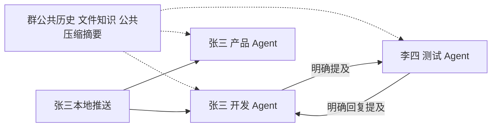

# V2 多岗位 Agent 与共享群上下文设计草案

> 这是 2026-10-19 的讨论快照。当前正式规则以 [CONTRACTS](CONTRACTS.md) 为准，实施与验收见 [IMPLEMENTATION](IMPLEMENTATION.md)。

更新：2026-10-19。依据七轮 Q1～Q55 整理。已选 Go 参考 Pi，四基础工具加群协作工具；同群共用聊天历史、对应内容和公共知识，各岗位的组合提示词不同。Q54 已确认工具内容自动共享，Q55 已确认多人闭环统一计数；编号问题全部回答，等待整体理解确认。本文用于讨论，未开始业务实现。

## 总体模型

群拥有一份公共业务上下文，群内每份成员 + 职位对应一个独立参与身份。所有岗位读取相同版本的公共历史、文件知识和压缩摘要，通过各自的职位 / 个人提示词形成不同视角。

独立的是身份、被唤醒后的执行、工具调用配对、取消与恢复状态；不再让每个岗位维护一份不同的长期业务记忆或压缩摘要。旧“每个 Agent 各自压缩群业务历史”的建议由本次补充替换。



虚线表示共享知识可用，实线表示唤醒。知识更新不会自动调用群内所有 Agent；本地推送只唤醒提交人自己的全部本群岗位，其他人的岗位需要明确 @。

## 已确认的触发规则

| 来源 | 处理 |
| --- | --- |
| 网页普通消息未 @ | 保存文字 / 文件与公共上下文，不唤醒 AI |
| 人明确 @ 岗位 AI | 唤醒指定的本群有效岗位身份 |
| 人或 AI @ 人 | 通知本人，不让其岗位 AI 代答 |
| 本地普通推送 | 唤醒提交人在本群全部有效岗位 AI，各自判断是否属于自己的事情，再决定发言、总结或 @ 协作者 |
| 本地只记录推送 | 保存内容，不发起自动 AI 分析 |
| AI 普通发言未 @ | 进入公共历史，不唤醒其他 AI |
| AI 明确 @ 岗位 AI | 只投递到明确目标 |
| 卡片继续 / 终止 | 按本次讨论记录的待执行目标和控制操作处理，不广播重新发起所有岗位分析 |

取消群级自动辅助 / 仅 @ 两种模式（Q53）。每次推送只记录的能力保留（Q23），不要求用户先选一个首响职位。各岗位判断不相关时可安静结束，是建议的消息体验，不把内部判断逐项变成群内发言。

运行中人追加内容并入公共历史和当前讨论，不刷新循环额度。未被点名的其他 Agent 保持空闲，下次被唤醒时再取得最新公共上下文。等待某人回答只影响依赖该问题的讨论，其他讨论继续。

## 组合提示词与共同知识

用户指定的五类业务输入都保留，并有准确来源：

| 输入 | 取值与范围 |
| --- | --- |
| 项目描述 | 当前群所属项目，对同群岗位共同提供背景 |
| 群描述 / 目的 | 当前群的协作目的，不自动带入其他群或父群内容 |
| 关联工作流 | 当前群关联的零个或多个流程，对同群岗位提供同一参考集合；岗位自行判断适配性 |
| 职位提示词 | 当前 Agent 对应的项目职位模板及本群任职 |
| 个人提示词 | 当前项目 + 对应本人 + 当前职位，不读取其他人的私人配置 |

平台执行契约与工具权限另外提供，不由业务提示词授权。项目、群和关联流程属于公共背景；职位与个人提示词按身份不同。

```text
岗位 i 的模型请求 =
  平台执行契约 + 项目描述 + 群目的 + 关联工作流
  + 职位 i 提示词 + 关联人该职位的个人提示词
  + 群公共上下文（相同版本内容一致）
  + 本次执行的工具调用 / 返回协议
```

公开历史保留每条消息的作者、岗位 AI 身份、消息序号、回复 / @ 关系和固定文件版本，避免把所有岗位发言压成没有作者的“agent 内容”。其他 AI 的公开发言是带作者的群记录，不冒充当前模型自己生成的 assistant 消息。

Q34 已确认直接使用新版配置，因此每次模型边界重建有效提示词。原先按岗位裁掉不同流程、只给协调者汇总意见、只读自身消息等规则不得继续改变公共业务上下文。

## 群公共知识与快照

建议由统一 GroupContext 服务生成带 groupId、contextRevision、messagesThroughSeq、文件版本集合和摘要版本的只读快照。同一快照对所有本群岗位内容相同；新消息形成新版本，已开始的请求仍有明确依据，后续模型边界纳入增量。

共同知识包含群聊天、已分享到本群的内容、文件版本及其公共可读内容。工具探索得到的本群内容与结果自动登记到公共知识，其他本群 Agent 可直接使用（Q54 B）。私人提示词、模型隐藏推理和取消 / 租约等执行控制数据不作为群公共知识。

原始文件较大时统一提供索引、公共摘要和可回读原文来源；不能给不同岗位悄悄截掉不同历史，再声称拥有相同知识。读取、摘要和引用均保持文件版本可追溯。

父子群仍是独立的信息范围，跨群只有经过明确分享的内容可以进入本群公共知识。归档群继续使用相同的消息、知识与触发规则。

## 公共压缩

压缩后的业务摘要按群组织并复用，不由每个岗位各自生成一份长期摘要。近期原文、公共摘要和原始来源共同构成上下文；原始记录保留可回读。

摘要记录覆盖序号与版本，保留当前目的、各方公开意见、分歧及作者、待回答问题、明确 @、下一步和文件依据。摘要不把未提到的异议解释成一致意见，也不把 AI 推测升级为人的工作验收。

建议由公共上下文模块在活跃处理期间按需生成 / 更新摘要，复用同一结果，避免每个岗位重复压缩；它不是选择协作者的主 AI。未被 @ 的岗位不为同步知识另行调用模型。

并发更新通过快照版本与去重控制，不共享可变模型消息数组。模型容量差异也应由统一上下文预算处理，保证相同快照的业务内容一致。压缩不改变当前权限和提示词配置，不重置讨论循环计数。

## 独立执行与四工具

继续 Go 执行底座参考 Pi（Q43），四基础工具为 read / bash / edit / write，增加少量结构化群协作工具用于发言、@、发布文件（Q44）。群管理与跨群分享由人操作，岗位 AI 不自主修改成员或群设置。

各运行独立保存 runId、Agent 身份、触发来源、工具调用与返回配对、执行副作用、租约、取消和沙箱现场。工具是否执行与业务知识是否公共是两个维度：可以把内容投影到公共知识，但不能把 A 的原始工具返回直接接到 B 的工具协议里，也不能让 B 误以为自己已执行 A 的操作。

建议不同岗位可并行处理，同一岗位的执行串行；群消息有统一顺序。服务端验证目标资格、持久化 @、去重与恢复，不替岗位 AI 判断应该找谁。未知副作用先核实，不盲重放。

基础设施可保留已有 Provider、工具日志、会话租约、沙箱和存储机制；旧 coordinator 专属同步父子调用、计划 / 任务分析收尾工具及节点门禁要退出 V2。

## 本地身份与投递

本地推送的默认目标由服务端按认证人 + 当前群枚举全部有效任职，而不是相信客户端自报身份或只读取本地选中的一个职位。消息、文件引用与目标触发采用同一来源标识和持久化去重。

没有有效本群任职时不能擅自唤醒其他人的 AI，应明确提示当前没有可自动分析的岗位身份；内容只记录的处理在 API 合同中明示。不会因本次共享上下文补充给本地工具开放其他群资料。

当前 CLI 已有 identity use，但 submit / report 未自动消费选中值，普通 submission 的可选 identityId 也未完成本人绑定核验。旧选择身份代码可用作参考，不能继续作为 V2 唯一首响选择机制。

## 循环限制与通知

项目设置上限为 10 个完整往返。A @ B → B @ A 算 1 轮，A → B → A → B → A 算 2 轮；普通群发言、工具调用和压缩不计入。A → B → C → A 等多人完整闭环也算 1 轮；同次讨论全部分支共享 10 轮上限（Q55 A）。

同次人工触发下，本人多岗位的分支和后续协作保留共同讨论来源。AI 消息、换参与者、重试、进程重启和补充资料不重置上限。具体闭环关系通过结构化 @ 与因果链记录，不能靠扫描显示文本猜测。

达到上限后，卡片允许任意人类群成员填写或留空继续，或终止本次讨论；通知本次相关岗位 AI 的关联人，同人多岗去重并复核当前群资格。操作记录版本和操作人，防止重复点击重复续开。

终止取消本次执行及待处理往返，不永久禁用群 AI；之后的新本地推送或明确 @ 仍可按规则发起讨论。卡片、消息、通知和运行控制各有记录，不引入工作完成 / 验收状态机。

## 当前实现事实与差距

| 当前事实 | V2 必须变化 |
| --- | --- |
| Go 自建 harness，四工具与工具日志已有 | 保留可用底座，执行主体改为对等岗位 |
| 公开历史已有统一读取器，但模型注入会丢部分作者和附件信息 | 建立带完整来源的群公共快照 |
| 当前按职位筛流程，岗位意见主要汇总给 coordinator | 同群业务上下文一致，差异由各岗位提示词表达 |
| 现有压缩只归档大块工具负载，生产链没有滚动聊天摘要 | 增加群级公共长会话摘要与原文回读 |
| read_context 限制 session / identity / binding，checkpoint 属于单次执行 | 不能直接作为公共知识；按 Q54 B 另建群级内容投影 |
| parent_run_id 与 rounds_reserved 属于旧主子模型 | 新建结构化提及、因果链与完整往返计数 |

核查依据：`internal/collaboration/history.go`、`internal/agent/context/context.go`、`internal/agent/batch/context.go`、`task_activity.go`、`public_opinions.go`、`context_tools.go`、`journal.go`、`recovery.go`、`internal/agent/runner/runner.go`、`tool_calls.go`、`compaction.go`、`internal/infrastructure/model/anthropic.go`。

Pi 压缩机制参考：[官方压缩文档](https://github.com/earendil-works/pi/blob/main/packages/coding-agent/docs/compaction.md)，资料核查日期为 2026-10-19；不直接引入 Pi 的 Node / TypeScript 运行层。

## 讨论收口

Q1～Q55 均已回答，没有待答的编号产品问题。共同知识包括本群工具取得的内容与结果；两人 / 多人闭环及各分支共享同次讨论 10 轮上限。原文见[讨论记录](DISCUSSION.md)，整合见[方案总览](REVIEW.md)。用户确认共同理解后再形成实施合同。
