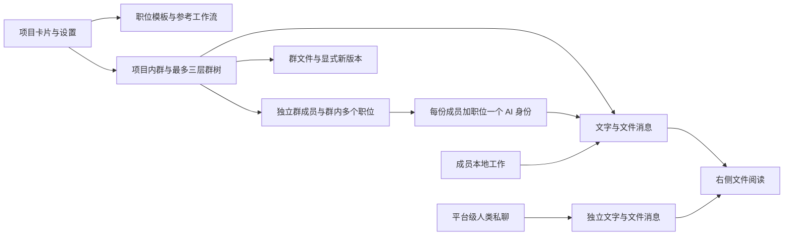

# V2 群聊协作与工作区设计草案

> 这是 2026-10-19 的讨论快照。当前正式规则以 [CONTRACTS](CONTRACTS.md) 为准，实施与验收见 [IMPLEMENTATION](IMPLEMENTATION.md)。

更新：2026-10-19。依据七轮 Q1～Q55 整理，冲突规则以较新答复为准；编号问题均已回答。后续已按用户要求制作 [桌面交互 Demo](PREVIEW.md)，用于核对视觉与操作路径。本文尚未冻结为后端 / Agent 实施合同，没有开始 V2 服务器重构。Agent 细化见[设计草案](AGENT-DRAFT.md)。

## 方案判断

方案可行，而且主线比原来的计划 / 任务系统更直接：项目管理人员、职位模板和流程参考；群承载实际协作；人和各自的岗位 AI 在群中沟通，本地工作成果通过消息与文件回流。

这会同时改变产品领域和界面骨架。前端重新组织导航与消息工作区，后端重新建立群成员、群内职位 AI、结构化提及、讨论运行和按群文件授权。旧计划 / 任务及其交付、交接、验收状态链退出 V2。

## 已确认的产品结构



| 对象 | 已确认的职责 |
| --- | --- |
| 项目 | 登录后的项目卡片入口；保留成员邀请、职位模板、参考工作流及设置，AI 协作循环上限在项目配置 |
| 群 | 有独立成员和消息 / 文件范围；可关联零个或多个流程；所有人类成员可共同管理 |
| 群树 | 根群 → 子群 → 孙群，最多三层，每层可有多个同级群；层级不授予读取权限 |
| 群内任职 | 从项目职位模板分配，一人可多岗，不同群可以不同岗 |
| 岗位 AI | 身份属于群 + 人 + 职位，各自组合提示词与独立执行；共享群业务知识和公共摘要，自主选择 @ 人或其他 AI |
| 个人提示词 | 项目 + 本人 + 职位范围复用；与群内业务记忆分开 |
| 业务记忆 | 同群全部 AI 共用历史、对应内容和公共知识；跨群隔离，父子群也须显式分享 |
| 私聊 | 平台范围同两人共用，纯人类；可发文件、右侧预览，不接入岗位 AI |
| 归档 | 已加入目标群的项目 owner / manager 可归档；父群与全部子孙群一起移入归档列表，仍可讨论 |

子群可以只包含项目中部分人员，这些人无须加入父群。新成员入群后可读该群完整历史和仍保留文件。侧栏只显示本人已加入的群；不能用未加入父群的名称补全目录。

## 群中工作的基本路径

1. 用户登录后直接显示项目卡片列表，点击卡片进入参考图式的项目群工作区（Q38 已明确）。
2. 从项目人员中按需组群，填写群目的，分配本群职位，按需选择参考工作流；直接拉人入群并通知。
3. 成员在群中发文字或文件，或由本地工具推送成果；单次本地推送可以只记录。
4. 本地推送唤醒提交人在本群的全部岗位 AI，各自判断是否属于自己的职责，再决定发言、总结和 @ 其他 AI；其他人的岗位只有明确 @ 才唤醒。网页普通消息未 @ 不触发，取消群模式开关，本地只记录保留（Q50～Q53）。
5. AI 综合群目的、项目描述、参考工作流、岗位及个人提示词决定如何参与。无适配流程也可自行判断。
6. AI 可以直接 @ 岗位 AI 请求协作，或者 @ 人询问 / 提醒；@ 人不会让其岗位 AI 自动代答。
7. AI 在本群发言、读文件、发布本群产物和 @，群管理与跨群分享由人执行。
8. 人通过讨论和实际产物判断工作结果。系统不维护计划完成、任务验收、交接接收等工作状态。

等待某人只影响需要其回答的问题，其他讨论继续；运行中追加人类消息并入当前讨论且不重置额度；参考配置更新后直接使用新版。创建表单的细节将在完整交互稿中列明；这里不增加必填目的或强制流程条件。

## 自动讨论与控制卡片

已确认：AI 之间连续互 @ 的循环限制在项目设置，用户给定 10 个完整往返。A @ B → B @ A 算 1 轮；普通公开发言、模型 / 工具调用不计入该轮数。追加消息和重试不刷新限额，多人完整闭环也算一轮，全部分支共享同次讨论 10 轮上限。达到后出现卡片，可带意见继续、留空继续，也可终止本次讨论。

卡片的建议表达如下；任意人类群成员可操作，通知本次讨论相关岗位机器人的关联人。完整往返单位已由 Q52 B 确认，不能把 10 轮显示成 10 条普通消息。

```text
本次 AI 协作已达到项目设置的循环上限

补充意见（可选）
[继续讨论]  [终止本次讨论]
```

继续时沿用公共群上下文；建议把补充意见作为群内可见消息，再增加一段有上限的运行额度。终止会取消本次讨论及其待执行互 @，不永久禁用群 AI，之后新的本地推送或明确 @ 仍可触发。可选意见的具体消息展现由交互合同细化。

通知按本次讨论涉及的岗位 AI 解析关联人，去重并复核当前群资格，点击可定位群和卡片。消息、卡片与通知分别持久化，避免多人同时点击导致重复续开；这是工程设计要求，不增加业务审批。

工程上将“群聊天”和“某次 AI 讨论运行”分开。运行是否排队、执行、等待继续、结束或失败属于技术状态，不决定人的工作是否完成。消息、上传与运行的可靠性记录不恢复旧业务状态机。

岗位 AI 自主选择对象与服务端可靠调度分开：每个岗位有自己的收件箱和执行记录，共同读取群公共上下文。服务端持久化明确 @、检查目标资格、去重、投递、取消待执行工作和控制资源。没有 @ 的 AI 消息只进入群历史，不唤醒其他 AI；公开请求、意见和结果在群里显示，工具细节收起（Q45、Q49）。

本地自动入口建议表达为平台生成的、指向提交人全部本群有效任职的触发事件；不额外唤醒其他人的岗位，也不另运行一个路由 AI。身份从认证人 + 当前群 + 有效任职核验，不要求指定唯一首响职位。

## 同群共同知识与不同提示词

最新补充要求所有本群 Agent 感知同一份聊天历史和对应内容。方案采用群级公共知识、公共文件内容与统一压缩摘要，按身份叠加职位和个人提示词；同一公共快照版本对所有岗位内容一致。

执行日志、工具调用配对、取消、租约和恢复状态仍归属于具体运行，不能误作为各岗位隔离的业务记忆。工具取得的本群内容和结果自动登记到公共知识，供其他本群岗位使用，保留来源（Q54 B）。群知识更新不要求所有岗位立即调用模型，未被点名者下次被唤醒时读取最新公共快照。

压缩按群生成并复用摘要，保留作者、分歧、文件版本和覆盖序号，不由不同岗位各自压掉不同历史。跨群仍按既定成员权限和显式分享隔离，个人提示词不复制进群公共知识。

## 群归档与登录入口的明确修正

Q37 的实际答复替换了此前的“归档停止新发言与 AI”推荐：群移入归档列表后仍可聊天和开展相同触发规则的 AI 讨论，文件与成员权限继续有效。归档只是列表归类，不能复用当前项目归档的写入屏障。Q47 已确认由已加入目标群的项目 owner / manager 操作，Q48 明确父群及全部子孙群一起归档；级联操作不让管理员获得未加入子群的消息、文件或目录读取权。

Q38 已确定为登录 → 项目卡片列表 → 点击项目 → 群工作区，不采用默认登录后直接恢复某个群的建议。项目卡片与群工作区承担不同层次的导航，项目内沿用参考图片的窄导航、会话列表、消息与文件阅读布局。

## 文件与成果

已确认同一文件可以明确新增版本，普通同名上传仍是独立文件。显式分享到另一个群的指定版本，对目标群成员可读，无须加入来源群。分享不是仅增加一条来源链接。

建议文件对象、不可变版本、消息附件引用、目标群授权分别建模，避免把一个项目级材料记录同时当作所有群的访问资格。物理字节是否去重复用由存储实现决定，不改变按群授权。

已确认的行为：

- 历史消息固定当时版本，群文件入口默认最新并提供历史切换；跨群分享固定指定版本（Q35、Q10）。
- 从群文件移除后，历史及其他群已分享版本保留可读，界面说明实际效果（Q36）。
- 任意人类群成员可维护文件，记录操作者（Q41）。
- 人可把消息、总结或文件明确分享到自己已加入的父群或子群，AI 不自主跨群分享（Q42、Q21）。

私聊附件保持私聊自己的访问范围，不自动加入项目或群文件；纯人类私聊不向 AI 提供文件上下文。

## 工作区与视觉建议

用户已确定最左侧“群聊 / 聊天”两类入口；项目内左边群列表、中间消息、右边文件内容。项目卡片继续承担项目选择与设置入口。

建议的桌面结构：

```text
应用窄导航 │ 当前项目群列表 │ 群消息与输入区       │ 文件阅读区
群聊       │ 根群           │ 群名、成员与轻量操作 │ 文件内容
聊天       │   子群         │ 人和岗位 AI 的消息  │ 版本与阅读工具
           │     孙群       │ 文件与讨论控制卡片  │
           │               │ 底部统一输入框       │
```

登录先显示项目卡片；项目内文件阅读区默认收起，点击文件后展开，关闭后聊天区变宽（Q38、Q39）。切换“聊天”进入平台私聊列表，项目选择不改变同两人的对话；群列表另有归档入口。

视觉建议围绕现有参考图，而不是再叠加管理后台标题区：

- 消息作为主要内容，减少重复的全局标题、项目标题和对象标题；设置通过群头部入口展开。
- 用头像、姓名、职位与明确的 AI 标识区分参与者，提及选择器同样区分人和岗位 AI。
- 以清晰字号、行距和留白组织阅读；边框、背景和强调色来自统一语义 token。
- 文件阅读区以实际内容为主，文件属性和操作保持轻量；讨论控制出现在消息流中的卡片。
- 文件、群设置、成员选择和工作流选择复用统一组件及交互规则。

HeroUI 仍是唯一基础 UI 库，保留中英文、浅色 / 深色主题和桌面 Web 范围。最终颜色、字号、圆角与密度在统一主题和交互稿中确认，不在业务组件中散落硬编码。

## 必须改变的架构边界

| 边界 | V2 改动与原因 |
| --- | --- |
| 协作对象 | 重建群、群成员、群内任职、消息与运行关系；旧计划 / 任务不能仅更名继续支撑页面 |
| AI 身份 | 群 + 人 + 职位各自有组合提示词和独立执行；群历史、文件知识与公共压缩摘要共同使用 |
| AI 通信 | 本地推送触发本人全部本群岗位判断职责，其他人的岗位通过明确 @ 协作；不采用主 AI 同步子调用或全群广播 |
| 提示词与压缩 | 五类业务提示词准确组合；建立统一群快照和公共长会话摘要，工具执行协议单独保存 |
| 授权 | 从项目成员可读改为群成员或私聊参与者可读；职位提示词不授予额外权限 |
| 文件 | 群内可见性与显式跨群分享形成独立关系，不能只增加旧项目资料的用途引用 |
| 上下文与沙箱 | API、搜索、预览、事件、CLI、检索和沙箱文件投影均按当前会话过滤；不能挂载整个项目目录再靠模型提示词避开其他群 |
| 前端 | 以群 / 私聊重新建立路由与数据层，统一消息与阅读组件；不继续依赖计划、任务 provider |
| 本地接入 | 按群权限读取消息 / 文件和推送内容，替换旧进度、交付接口（Q40） |
| 归档与通知 | 管理员归档父群级联全部子孙群且不冻结讨论；卡片可由任意群成员控制，并通知相关岗位关联人 |

群退出 / 移除后不再具备群读取或 AI 执行资格，是按群成员授权的直接要求；撤销必须贯穿排队工作、运行工具、事件和预览能力。已发消息与作者记录的保存策略需在完整生命周期合同里明确，不能靠删除账号顺带级联清空。

已选继续 Go 执行底座参考 Pi，不直接引入 Pi 运行时；四基础工具之外允许少量群协作工具（Q43、Q44）。保留可用认证、数据库与对象存储基础、模型接入、工具执行与可靠性机制、文件转换器及统一 UI 组件，同时重建对等协作、共享群上下文和缺失的公共长会话压缩。

## 后续形成的合同与验证

编号问题已收口，完整路径与架构边界见[方案总览](REVIEW.md)，等待用户确认共同理解。再形成领域 / 权限、API / 事件 / CLI、AI 运行、消息 / 文件、前端组件与 E2E 验收合同，更新正式产品和详细设计文档。

验收建议覆盖：登录项目卡片路径、三层群与独立成员、父群级联归档后仍可讨论、同人多岗独立 Agent、本地唤醒本人全部岗位与明确 @ 投递、同群公共快照 / 摘要一致、不同职位与个人提示词正确、完整往返限额及卡片通知 / 继续 / 终止、压缩后续接、新配置生效、文件版本与显式分享、本地推送、平台私聊，以及 API / 搜索 / 事件 / 预览 / 沙箱的隔离。桌面端统一检查中英文和深浅主题。此处是待实施的验收范围，没有声称这些 V2 场景已经通过测试。

原有历史兼容可以废弃是项目已有授权；当前讨论阶段不会执行清库或替换正常运行的 V1 服务。
