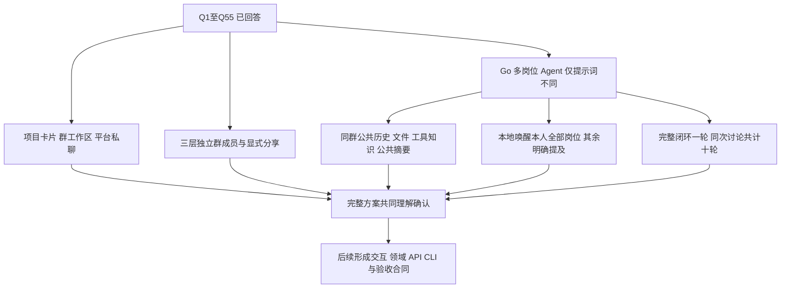

# V2 讨论记录

更新：2026-10-19。状态：七轮 Q1～Q55 全部已回答；当前编号决策前沿为空，等待完整方案的共同理解确认。较新答复优先，当前总览见[方案总览](REVIEW.md)。当前确定规则见[已确认决定](DECISIONS.md)；本文保留各轮推荐与实际答复，二者不混用。

## 一、问题的性质与初步判断

方案在技术上可行，产品主线将从“项目 → 计划 / 任务 → 讨论、交接、验收”改为“项目 → 按需组群 → 职位机器人协作与成员本地成果回流”。这是协作对象和使用流程的重建，同时包含视觉设计、消息体验和文件工作区的重构。

群层级表达话题或协作空间的组织关系，不承载任务依赖、交付状态、验收职责或完成进度。用户在 Q1 A 中已明确取消这些工作状态机，工作流和职位仅用于 AI 理解背景与角色，执行结果由人自行解决。

保留认证、PostgreSQL、对象存储、模型 Provider、harness / 沙箱和 HeroUI 基础组件，是可行的工程建议；需要重写群成员、群内职责、会话上下文、消息投递、文件访问和页面路由等协作领域。该建议尚不是最终实施拆分。

## 二、用户原始方向的保留与歧义

完整方向见[本计划入口](README.md)。以下记录第一轮提出时的两处歧义及其已得到的回答：

- 子群数量：原话同时出现“多个子群”和“最多一个子群”；Q2 A 已确认多个同级子群、总深度三层。
- 群文件：第一轮区分展示归集和访问权限；Q3 A 已确认按群成员隔离消息与文件。

用户明确取消计划和任务；Q1 A 进一步确认移除其正式分工、交接和验收等工作状态链。后续围绕群协作展开，不反复要求用户保留旧业务对象或业务门禁。

## 三、现状事实与重构影响

以下由只读源码核查得到，不需要用户回答技术现状。

| 当前事实 | V2 的影响 | 主要依据 |
| --- | --- | --- |
| 计划 / 任务承载正式安排、交付、交接和验收状态；议题只承载讨论 | 需要决定是否取消这些正式语义，不能只换对象名称 | [业务对象设计](../../详细设计/02-业务对象与协作流程.md)、`internal/work/reports.go`、`internal/work/acceptances.go`、`internal/handoff/service.go` |
| 讨论和材料按项目成员授权，没有真正的群成员模型 | 按需拉人组群需要新的成员关系和生命周期；群文件若要求私密，需要改变授权边界 | [身份权限](../../详细设计/01-产品边界与身份权限.md)、`internal/discussion/service.go`、`internal/material/service.go` |
| 当前父子议题是 `parent_topic_id + fork_after_seq` 的共享历史分叉 | 不能直接复用为子群；历史、文件、成员继承和三层限制均需重新定义 | [分叉说明](../../功能/会话任务协作与分叉.md)、`internal/collaboration/history.go` |
| 职位模板、稳定任职身份及人员绑定属于项目；个人偏好按项目、用户和职位读取 | “建群时指定职位”可能改变身份和提示词作用范围，须先决定职责在项目还是群内分配 | `internal/project/identities.go`、`internal/project/preferences.go` |
| Agent 采用协调者委派、岗位返回的中心调度，岗位不能自由互相递归委派 | “机器人互相沟通”若意味着自主互相寻址，将改变已确定的执行边界；触发和停止策略需要另轮讨论 | [Agent 设计](../../详细设计/06-Agent执行与上下文.md)、`internal/agent/batch/batch.go`、`internal/agent/batch/positions.go` |
| 沙箱只读挂载项目共享目录；Agent 材料读取和知识搜索按项目过滤 | 群隔离若成立，Web、API、搜索、预览、签名能力、CLI、Agent 目录投影和检索都要同步改造 | [工作目录设计](../../详细设计/11-工作目录与动态上下文.md)、`internal/agent/batch/materials.go`、`internal/agent/batch/context_tools.go` |
| SSE 按项目广播事件，包含对象 ID、类型和版本 | 私密群与人类私聊需要在事件出口同样检查会话访问资格 | `internal/transport/http/events.go` |
| 未发现人类私聊、会话成员、消息已读游标、在线状态或输入中状态的数据模型；通知已读不等于聊天已读 | 私聊属于新增领域；必须在服务端禁止 Agent 调度，不能仅隐藏机器人 UI；其他即时通信能力按后续范围决定 | 当前数据库迁移、OpenAPI、`internal/discussion/service.go` |
| CLI 已支持文字、文件和可选 topic 的幂等提交；正式 progress / delivery 依赖 task | 可建立群投递和群上下文合同，旧工作报告 / 待办接口需随领域重构清理 | [本地接入设计](../../详细设计/07-API事件与本地接入.md)、`internal/cli/cli.go` |
| 当前聊天路由和数据层深度依赖计划 / 任务；分栏、草稿、阅读器等共享能力独立存在 | 重建工作区骨架，保留可用基础交互；桌面、中英文、深浅主题和统一 token 约束继续适用 | [聊天工作区](../../界面/聊天工作区.md)、`web/src/features/chat/ChatWorkspace.tsx`、`SidebarConversations.tsx`、`WorkspacePanel.tsx` |

## 四、当前设计树

七轮 Q1～Q55 均已回答，当前没有待回答的编号产品问题。Q54 已确认工具取得的本群内容自动进入公共知识，Q55 已确认多人闭环也算完整一轮。整体核对见[方案总览](REVIEW.md)。实施合同、交互稿和代码尚未开始冻结或执行。

编号问题已经收口，等待用户核对完整方案。实施中的 schema、模型预算数值、控件细节和部署拆分属于后续合同设计，本文不把未讨论细节静默当成已确认产品规则。

## 五、第一轮问题（Q1～Q6）

### Q1：删除计划和任务后，是否还需要系统管理交付、接收和验收？

- A：群是协作空间，工作通过文字、文件和人的沟通推进，不再维护正式交付 / 交接 / 验收状态机。
- B：仍需要结构化正式决定和验收，但用新的群内业务对象定义，后续重新讨论职责和状态。
- 推荐 A：先实现群目的、讨论、成果文件和人的结论；置顶、归档等属于后续待确认设计，不作为隐形任务系统。
- 用户答复：A。补充明确工作流和职位只用于 AI 认清与扮演角色，实际工作执行由人自行解决，去除工作状态机。

### Q2：子群是可分支的三层树，还是每层仅一个子群的链？

- A：一个群可有多个同级子群，最多为根群 → 子群 → 孙群三层总深度。
- B：每个群最多一个直接子群，最多三层，形成单链。
- 推荐 A：可以同时承载前端、后端、测试等独立讨论；层级表达组织关系，不自动表示先后执行或完成进度。
- 用户答复：A。多个同级子群，根群、子群、孙群三层总深度。

### Q3：同项目但没有加入某群的人，能否读取该群的消息和文件？

- A：只有该群成员和获准在该群工作的机器人可读取。
- B：项目成员均可读取，群成员只决定参与者和提醒对象。
- 推荐 A：邀请组群同时形成清晰的协作与信息范围。管理员可见性、父子群继承、转发与退出后访问等，留待这一决定后再逐项确认。
- 用户答复：A。V2 改为群成员隔离，改变当前项目级共享边界。

### Q4：建群时的职位，是选择成员已有的项目任职，还是按项目模板分配本群职责？

- A：只能选这个人在项目里已经承担的职位；群内选择不改变其项目任职。
- B：项目管理职位模板，群内给成员分配本群职责；同一个人在不同群可以承担不同职位。
- 推荐 B：更符合按需组群的方向；群内职责与管理权限、文件可见性分别表达。具体机器人身份及个人提示词如何随之组织，下一轮再定。
- 用户答复：B。群内按项目职位模板分配职责；具体 AI 身份和偏好组织方式继续讨论。

### Q5：纯人类私聊属于当前项目，还是整个平台注册人员之间的通用聊天？

- A：项目内私聊；同两人在不同项目拥有独立对话。
- B：平台级私聊；不随切换项目而改变，同一对用户共用对话。
- 推荐 A：先延续项目成员和资料范围，最左侧在当前项目中切换群聊 / 私聊。纯人类、服务端不调度机器人是用户已提出的方向，不再作为可选项。
- 用户答复：B。采用平台级私聊；第一轮推荐 A 未被采用，不能继续按项目内私聊设计。

### Q6：一个群可选关联一个工作流，还是同时关联多个？

- A：零个或一个。
- B：零个或多个。
- 推荐 A：先保持群目的与流程参考清楚，后续明确无流程群的机器人参与方式、流程版本更新和必要约束。若选 B，再单独定义规则冲突和使用范围，不能由模型临时猜测。
- 用户答复：B。允许关联多个工作流；结合 Q1，所有流程仅作为 AI 参考，不能变回业务执行引擎。

## 六、第一轮用户答复原文

> Q1 A 就是让AI辅助大家在群里工作，状态机的问题直接去除，对应的项目工作流和职业也只是为了让AI认清和扮演角色，具体工作执行的怎么样让人自行解决
>
> Q2 A
>
> Q3 A
>
> Q4 B
>
> Q5 B
>
> Q6 B

## 七、第二轮问题（Q7～Q16，已回答）

### Q7：子群成员必须来自父群，还是可独立从项目成员中选择？

- A：子群成员必须已经是父群成员。
- B：每个群独立选项目成员；可以只加入子群，没有父群消息和文件读取权。
- 推荐 B：父子关系负责话题组织，成员和可见性分别管理。父子群自动交换历史 / 文件 / 总结的规则留待成员关系确定后再问。
- 用户答复：B。子群独立从项目成员中选人，不要求加入父群。

### Q8：新加入群的成员能否看入群前的消息和文件？

- A：能看该群完整历史及仍保留的群文件。
- B：默认只看加入之后的内容，旧内容另行分享。
- 推荐 A：让后来加入的协作者可以理解已有讨论与成果；涉及更小受众的内容用独立群组织。退出 / 移除后的访问与已有下载边界另行讨论。
- 用户答复：A。入群成员可看群内完整历史和仍保留文件。

### Q9：群管理权如何分配？

- A：创建者成为群主，可以指定群管理员；由群主 / 管理员维护成员、群简介、职位及流程关联。
- B：所有群成员均可修改这些群设置与成员关系。
- 推荐 A：群管理权与 AI 扮演的职位独立，普通业务讨论不需要审批。项目成员可自主建群的原始方向保留。
- 用户答复：B。所有群成员均可维护群设置与成员；是否允许岗位 AI 自主执行管理操作继续讨论。

### Q10：明确把甲群文件分享到乙群后，未加入甲群的乙群成员能否读取？

- A：允许，分享指定文件版本使其在乙群内可读；不开放甲群其他内容。
- B：只产生来源链接，仍需甲群成员资格才能读取。
- 推荐 A：分享是明确的信息转移；不能由 AI 或父子关系自动扩大受众。谁能分享、原件更新 / 删除后如何处理，后续单独确认。
- 用户答复：A。指定文件版本明确分享到目标群后，对目标群成员可读。

### Q11：同一个群里，两个人都担任开发职位时，是两个机器人还是一个共用机器人？

- A：每份“群成员 + 本群职位”对应独立 AI 工作身份，同岗多人各自有机器人。
- B：每个群内职位只有一个机器人，同岗成员共用。
- 推荐 A：便于对应本地成果来源和个人工作偏好；机器人发言与本人发言明确标识。身份更换与记忆范围留待此项确定后讨论。
- 用户答复：A。每份群成员 + 职位对应独立 AI 身份，同岗多人不合并。

### Q12：群中的消息和文件怎样触发 AI？

- A：用户发送文字或文件后自动开始辅助讨论。
- B：只有明确 @ 机器人或请求 AI 分析时才回应。
- C：每群可选择上述模式。
- 推荐 C，默认自动辅助：群定位为 AI 协作空间；本地推送可明确选择只记录、不触发讨论。讨论上限、无新信息时停止和机器人消息是否触发后续，由运行组织方式确定后再展开。
- 用户答复：C。每群可配置模式；默认模式及本地只记录控制尚未明确。

### Q13：机器人讨论仍由协调者组织，还是岗位机器人能直接相互调度？

- A：协调者组织群内相关岗位 AI，岗位分别分析和发言，协调者整理结果。
- B：各岗位 AI 可以直接相互点名、请求协作和转交工作。
- 推荐 A：保持各岗位可见发言与职责区别，由协调者组织一次讨论；流程只提供参考，不增加人工工作状态或验收门禁。
- 用户答复：B。岗位 AI 自行选择 @ 对应岗位 AI 或人，综合工作流、岗位及个人提示词考虑。

### Q14：多个工作流如何供群内 AI 参考？

- A：关联流程作为群公共参考，AI 结合群目的、当前问题和职位选择相关内容。
- B：需要人为给各职位指定参与哪些流程 / 环节。
- 推荐 A：减少群配置负担。AI 不能将参考内容升级为业务门禁；流程变化、矛盾和未关联流程时的默认行为随后细化。
- 用户答复：A。AI 自行选择适配的关联工作流，无适配则自行判断。

### Q15：平台用户能否直接搜索其他用户并发起私聊？

- A：可直接搜索平台注册用户、发起私聊，无需先成为好友。
- B：先通过联系人申请，再允许聊天。
- 推荐 A：适合当前内部协作平台；不引入项目归属限制，未读、屏蔽和用户停用后的处理另行讨论。
- 用户答复：A。可搜索平台注册用户直接私聊，不要求好友申请。

### Q16：平台级私聊是否同样支持文件和右侧预览？

- A：支持文字、文件与右侧预览，附件只属于这段私聊，不自动进入任何项目或群文件。
- B：首版私聊只做文字。
- 推荐 A：复用统一消息及阅读体验，私聊文件保持独立访问范围，项目机器人不能自动读取。
- 用户答复：A。平台私聊支持文字、文件与右侧预览，附件属于该私聊。

## 八、第二轮用户答复原文

> Q7 B
>
> Q8 A
>
> Q9 B
>
> Q10 A
>
> Q11 A
>
> Q12 C
>
> Q13 B 机器人其实就是对应岗位的人替代，机器人可以决策是@对应的职位机器人替代还是 @ 对应的人，@谁可以在工作流中或者职位的提示词，个人提示词进行综合考量
>
> Q14 A 让AI 自行决策当前适配哪个工作流程没有则自行决策
>
> Q15 A
>
> Q16 A

## 九、第三轮问题（Q17～Q27，已回答）

### Q17：@ 人和 @ 他的岗位 AI 是否明确区分响应？

- A：@ 人只提醒本人，等待本人主动回复；@ AI 才唤醒该 AI。
- B：@ 人也允许其岗位 AI 先代为回复。
- 推荐 A：在选择器和消息中区分真实用户与岗位 AI，岗位自主选择对象不改变被点名对象的含义。不会因 @ 人而启动本人电脑的本地 AI。
- 用户答复：A。@ 人只通知本人，@ 岗位 AI 才请求该 AI 响应，两类目标明确区分。

### Q18：同一人在同一个群能否兼任多个职位？

- A：同群每人一个职位。
- B：同群每人可多个职位，每个职位对应独立 AI 身份。
- 推荐 B：支持一人兼顾开发、设计等实际场景；如何选择自动模式的首个响应身份，等职位数量和模式默认值明确后再问。
- 用户答复：B。同人在同群可兼任多个职位，每份成员 + 职位有独立 AI。

### Q19：个人提示词按项目职位共用，还是每个群独立？

- A：项目 + 本人 + 职位一份，同项目相同职位在多个群复用。
- B：群 + 本人 + 职位一份，每群分别配置。
- 推荐 A：个人工作习惯集中维护，群差异由群目的、群内职责及流程参考补充；跨项目不混用。个人原文继续按私人配置处理，不因为群成员共同管理就公开给他人。
- 用户答复：A。个人提示词按项目 + 本人 + 职位配置，在同项目多个群复用。

### Q20：同一人的同岗位 AI 能否自动带入其他群的经验和信息？

- A：对话、业务记忆按群隔离，跨群内容须通过明确分享进入。
- B：可跨群复用该人有资格读取的信息。
- 推荐 A：一个人的可读范围不等于当前群所有成员的可读范围。个人工作方式提示词与业务记忆分开，其配置范围单独由 Q19 确定。
- 用户答复：A。业务对话和记忆按群隔离，其他群内容须明确分享。

### Q21：岗位 AI 能否自主使用人的群管理及跨群分享能力？

- A：默认在当前群发言、读文件、发布本群产物、@ 参与者；成员 / 职位 / 工作流变更和跨群分享由人操作。
- B：岗位 AI 可以代表对应人自主执行这些管理与分享操作。
- 推荐 A：自主选择协作对象与维护群授权分别表达。Q9 的成员共同管理继续有效，本题只确认是否同时开放给机器人的自主执行。
- 用户答复：A。AI 在本群发言、读文件、发布产物和 @；群管理及跨群分享由人操作。

### Q22：新群默认采用哪种 AI 模式？

- A：默认自动辅助。
- B：默认仅明确 @ 或请求分析时参与。
- 推荐 A，保持随时可改为 B。Q12 只确认模式可配置，没有将上一轮推荐的默认值自动当作用户答复。
- 用户答复：A。新群默认自动辅助，可切换为仅 @。

### Q23：本地推送是否允许明确选择只记录、不触发 AI？

- A：允许；即使群是自动模式，本次推送也可只登记文字与文件。
- B：不提供单次控制，始终按群模式处理。
- 推荐 A：便于连续推送资料或保存阶段内容；该选择控制本次是否唤醒，不撤销其他已经开始的讨论，后续消息的回应行为按具体触发规则另行确定。
- 用户答复：A。本地单次推送可只记录，即使本群处于自动模式。

### Q24：岗位 AI 互相 @ 的一次自动讨论是否有群级总上限？

- A：按一次人工触发的讨论链共享总上限，机器人互 @ 不重置；达到后结束自动往返，由人决定是否继续。
- B：只由各岗位 AI 自行决定何时停止，不设置群级讨论总上限。
- 推荐 A，并允许 AI 提前结束。它限制自动运行，不引入工作完成、验收或流程门禁；上限数值和交互提示在选择后细化。
- 用户答复：自定义补充：有总上限；达到后显示卡片，可点击继续，可填写意见也可留空，还可终止聊天。终止范围和运行控制细节在第四轮确认。

### Q25：没有加入的群，其名称和目录是否可见？

- A：只列出 / 搜索本人加入的群；可访问子群独立显示，不泄露未加入父群名称。
- B：项目内可见全部群名称 / 目录，只限制消息和文件读取。
- 推荐 A：保持信息边界一致。存在不可访问祖先的子群如何在侧栏排布，按此决定继续画交互。
- 用户答复：只显示已经加入的群。

### Q26：成员拉项目内人员入群，是否需要受邀人确认？

- A：直接加入并通知受邀人。
- B：受邀人接受后才加入。
- 推荐 A：内部按需组群操作直接；Q8 已确认加入后可见完整群历史，邀请操作应展示这个实际效果。权限主体是否包括 AI 另由 Q21 决定。
- 用户答复：A。直接加入并通知受邀人，无须接受邀请。

### Q27：群文件是否支持明确更新为新版本？

- A：每次上传都作为独立附件，不提供版本更新入口。
- B：支持明确更新指定文件产生新版本；普通同名上传仍是独立文件，不按名称自动覆盖。
- 推荐 B：便于同一方案持续修订，也避免同名文件混在一起；现有消息和分享指向哪个版本、删除如何传播，等这项确定后再讨论。
- 用户答复：B。支持明确更新同一文件的新版本，同名普通上传仍为独立文件。

## 十、第三轮用户答复原文

> Q17 A
>
> Q18 B
>
> Q19 A
>
> Q20 A
>
> Q21 A
>
> Q22 A
>
> Q23 A
>
> Q24 有总上限，然后可以出现卡片可以点击继续有个输入框可以写意见也可以不写让其继续聊天然后还可以点击终止聊天
>
> Q25 只显示已经加入的群
>
> Q26 A
>
> Q27 B

## 十一、第四轮前的事实补查

以下仅描述当前 V1，不表示相同行为已被选为 V2 规则。

- 文件对象与不可变版本已有独立模型；消息固定引用当时版本，资料库展示最新版本，预览地址和缓存绑定版本 ID。目前缺少历史版本切换和有新版提示。依据：`internal/material/service.go`、`internal/material/library.go`、`internal/material/file_preview.go`、`web/src/features/materials/FileCard.tsx`、`MaterialDialog.tsx`。
- 现有“发送到讨论”只新增同项目固定版本引用，不改变受众；材料软删除会隐藏整个项目文件但保留历史下载，无法表达按群授权及单群撤销。V2 需重建群文件与显式分享关系。依据：`internal/discussion/service.go`、`internal/material/library.go`、`web/src/features/materials/MaterialSharing.tsx`。
- 现有取消操作针对 run / batch，有后端与 CLI，正式聊天工作区尚未接入取消按钮；续开 API 增加旧 batch 轮次且受累计预算限制，只有项目管理者可用，没有卡片和补充意见输入。不能把已有 API 当作 V2 卡片已经具备。依据：`internal/agent/batch/service.go`、`internal/transport/http/agent.go`、`internal/cli/cli.go`、`web/src/features/chat/ConversationHeading.tsx`。
- 当前新增意见通常建立独立 batch；旧 batch 的历史截止位置不会自动纳入后来消息。V2 如需并入当前讨论，必须重建消息接入与运行边界。依据：`internal/collaboration/enqueue.go`、`internal/agent/batch/context.go`、`internal/agent/batch/session.go`。
- 当前岗位绑定替换使旧授权运行失效，但会话不重建；职位 / 个人提示词变化则在下一次模型请求读取新版，不主动取消当前请求。它们可作为可靠性参考，不能继续沿用 V1 项目级身份与群级身份混同的模型。依据：`internal/project/identities.go`、`internal/project/preferences.go`、`internal/agent/batch/positions.go`、`internal/agent/batch/context.go`。

## 十二、第四轮问题（Q28～Q42，已回答）

### Q28：自动模式下，没有明确 @ 对象的新消息由谁先处理？

- A：群内各岗位 AI 判断是否与自己相关，相关者再回应或 @ 协作者。
- B：每群指定一个首响 AI，由它开始后续沟通。
- 推荐 A。符合岗位自主参与的方向；不相关的岗位可以保持安静，并不要求每个 AI 都发言。
- 用户答复（历史）：A。群内各岗位 AI 自行判断普通新消息是否相关，相关者参与。此规则已由第五轮 Q45 的“本地提交人自己的岗位 AI 先处理，后续仅明确 @”替换，不能继续作为当前规则。

### Q29：AI @ 人等待回答时，是否暂停整个群的 AI 讨论？

- A：只等待涉及本人的问题，其他不依赖该回答的讨论可以继续。
- B：整个群的 AI 讨论暂停，等被 @ 的人回复后再继续。
- 推荐 A。保留人的回答权，同时不把一个待答问题变成整个群的工作门禁。
- 用户答复：A。只等待需要本人回答的问题，其他不依赖该回答的讨论继续。

### Q30：AI 正在讨论时，人追加文字或文件如何处理？

- A：并入当前讨论，后续回复考虑新内容，不重置当前讨论额度。
- B：每条新增内容发起独立讨论，分别计算额度。
- 推荐 A。减少重复分析；只记录的推送仍不主动唤醒 AI，已发出的回复不因追加内容而被改写。
- 用户答复：A。人追加的文字和文件并入当前讨论，后续回复考虑新内容，不重置额度。

### Q31：终止聊天按钮停止什么？

- A：终止本次 AI 讨论及其待执行的互 @；之后的新消息仍按群模式触发新讨论。
- B：同时关闭本群自动 AI，直到成员重新开启。
- 推荐 A。按钮可明确叫“终止本次讨论”，普通人类聊天照常进行。
- 用户答复：A。终止本次 AI 讨论及待执行互 @，之后的新消息仍按群模式触发。

### Q32：继续 / 终止卡片由谁操作？

- A：群内任意人类成员都可以操作。
- B：只有本次讨论的最初发起人可以操作。
- 推荐 A。与群成员共同管理的方向一致；继续时沿用本次讨论上下文，建议把可选补充意见作为群内可见消息。
- 用户答复：自定义补充：群内任意人员可操作，并希望卡片通知到本次讨论相关岗位机器人的关联人。

### Q33：自动讨论上限如何设置？

- A：群内可配置，每段默认最多 10 条 AI 发言；点继续后再获得同样一段额度。
- B：由平台统一配置，各群不能修改。
- 推荐 A。人类消息和工具内部调用不计入这个界面上的发言数；AI 互 @ 不刷新额度，平台另有技术资源上限。默认 10 条属于本轮建议。
- 用户答复：自定义：在项目设置讨论上限，不采用上一轮推荐的群级配置；计数单位、默认值仍待确认。

### Q34：项目职位提示词 / 工作流模板修改后，群是否自动使用新版本？

- A：后续 AI 回复使用最新配置，保留原群历史。
- B：群固定使用关联时的版本，由成员手动升级。
- 推荐 A。它们是协作参考，避免维护多套旧配置；已发出的内容保留，正在进行的一次模型请求不会被即时改写。
- 用户答复：直接使用新版配置。

### Q35：更新文件后，历史消息打开哪个版本？

- A：历史消息固定当时版本；群文件列表默认最新，并能切换历史版本。
- B：历史消息也自动打开最新版。
- 推荐 A。便于还原当时讨论依据。Q10 已确认的跨群分享始终指向指定版本，本题不重新改变该决定。
- 用户答复：A。历史消息指向当时版本，群文件列表默认最新并可切换历史。

### Q36：从群文件移除一份文件时，旧引用如何处理？

- A：从本群文件列表移除；历史消息及已经明确分享给其他群的版本仍可读。
- B：撤销源文件所有版本，历史消息和其他群的分享都不可读。
- 推荐 A。把移除与彻底撤销区分开，保持已有讨论依据；操作文案应说明实际效果。
- 用户答复：A。从群文件列表移除，历史消息与已分享到其他群的版本仍可读。

### Q37：一个群不再使用时，首版需要哪种收尾能力？

- A：只做可恢复归档，历史可读；父子群分别归档。
- B：归档之外，还需要永久删除群及其内容。
- 推荐 A。归档群停止新发言和 AI 运行，恢复后可继续使用；归档不表示工作被验收完成。若需要永久删除，再细化子群与分享传播。
- 用户答复：自定义替换：管理员可将群设为归档，放入归档列表；归档群仍可讨论。此前“归档后停止发言与 AI”的推荐不采用。

### Q38：群聊入口默认打开哪里？

- A：先显示保留的项目卡片，再进入项目的群工作区。
- B：直接恢复上次项目和群，项目卡片通过切换入口打开。
- 推荐 A。先延续你提出的项目卡片入口；平台私聊由最左侧“聊天”独立进入，切换时保留群工作区上下文。
- 用户答复：明确登录流程：用户登录之后直接进入项目卡片列表，点击卡片进入参考图片中的群工作区。

### Q39：右侧文件阅读区是否始终占位？

- A：默认收起，点击文件后在右侧展开，关闭后聊天区变宽。
- B：始终保留右侧区域，未选文件时显示群文件列表。
- 推荐 A。让对话获得更多空间；文件仍在当前工作区查看，可进一步全屏阅读。
- 用户答复：A。文件阅读区默认收起，点击文件展开，关闭后聊天区变宽。

### Q40：本地工具是否同时支持读取群上下文？

- A：可以读取指定群的消息和文件，也可以推送文字和文件。
- B：只负责推送，读取上下文通过网页完成。
- 推荐 A。本地工作可利用群内讨论，但只允许读取当前账号有资格访问的指定群；不因本地工具而扩大权限。
- 用户答复：A。本地工具可读取有资格访问的指定群消息 / 文件，也可推送文字 / 文件。

### Q41：群文件由谁更新和移除？

- A：任意人类群成员都可以维护。
- B：只有上传者或将文件分享到本群的人可以维护。
- 推荐 A。便于共同修改成果，记录每次操作者；它不把群管理能力开放给 AI，机器人仍按 Q21 的范围发布产物。
- 用户答复：A。任意人类群成员可更新和移除群文件。

### Q42：父子群之间如何回流讨论成果？

- A：人可以选择消息、总结或文件，明确分享到自己已加入的父群或子群。
- B：仅提供已确认的文件分享，文字内容自行复制。
- 推荐 A。用显式分享衔接父子群，AI 记忆与成员权限仍然隔离，不自动读取或汇报到另一个群。
- 用户答复：A。人可显式选择消息、总结或文件，分享到本人已加入的父群或子群。

## 十三、第四轮用户答复原文

> Q28 A
>
> Q29 A
>
> Q30 A
>
> Q31 A
>
> Q32 任意人员，然后最好卡片通知到对应讨论的职位机器人的关联人
>
> Q33 项目设定
>
> Q34 直接使用新版
>
> Q35 A
>
> Q36 A
>
> Q37 管理员可以将群设置为归档，然后在归档列表中，里面还是可以讨论
>
> Q38 应该是逻辑这样的用户登录之后直接是项目卡片列表，然后点击卡片之后进入前面图片的操作界面
>
> Q39 A
>
> Q40 A
>
> Q41 A
>
> Q42 A
>
> 然后整体聊天 agent 可能应该是多 agent 模式，而不是以前的单 agent 然后 subagent 模式，这里也得考虑，多个 agent 也就是 pi agent 4个工具+上下文压缩，各个 agent 提示词就是根据群+项目描述 + 工作流 + 职位 + 个人提示词来组合而成，这个得注意对应
>
> Q38Q37

## 十四、本轮新增的 Agent 方向与事实核查

用户要求多个独立岗位 Agent，每个有 Pi 风格四工具和上下文压缩；业务提示词由群、项目描述、工作流、职位、个人提示词组合。这是当前 V2 设计方向，不把“参考 Pi”与“直接使用 Pi 包”混写为已确认选型。

- 当前没有引入 Pi 包，实际是服务端 Go harness。四工具已经接线到 OpenSandbox，但执行模型仍按协调者 + 同步子调用组织。依据：`docs/详细设计/06-Agent执行与上下文.md`、`internal/agent/batch/positions.go`、`internal/agent/runner/runner.go`。
- 现有压缩主要把大块探索工具结果替换成 PostgreSQL 可回读引用；没有生产接线的长对话滚动摘要，不能声称已有完整独立 Agent 长会话压缩。新 run 也不会自动完整续接上一 run 的模型 transcript。依据：`internal/agent/runner/compaction.go`、`internal/agent/context/context.go`、`internal/agent/batch/context.go`。
- 当前系统只有项目 owner / manager / member；没有产品内平台管理员。现有项目归档会阻止消息和 AI 写入，不能直接复用来实现“归档群仍可讨论”。依据：`internal/project/members.go`、`internal/project/service.go`、`internal/infrastructure/postgres/tx.go`。
- 现有通知可以逐用户存储、按事件去重，但主要生产者是交接提醒，没有讨论卡片及岗位参与人通知。已有消息序号定位可以复用，收件人和卡片引用须重建。依据：`internal/handoff/reminders.go`、`internal/transport/http/events.go`、`web/src/features/chat/Conversation.tsx`。
- Pi 官方 SDK 支持在 Node / Bun 中创建独立 AgentSession；会话管理消息、工具、排队输入和压缩状态。参考 [Pi SDK](https://github.com/earendil-works/pi/blob/main/packages/coding-agent/docs/sdk.md) 和 [压缩机制](https://github.com/earendil-works/pi/blob/main/packages/coding-agent/docs/compaction.md)，核查日期 2026-10-19。直接引入该运行时属于 Q43 选型，尚未决定。

## 十五、第五轮问题（Q43～Q49，已回答）

### Q43：Pi 是执行方式参考，还是直接采用 Pi 运行时？

- A：继续 Go 执行底座，参考 Pi 的四工具与上下文机制，重建独立岗位 Agent。
- B：直接采用 Pi 运行时，增加独立的 Node / TypeScript 执行层，与 Go 业务服务对接。
- 推荐 A。对等多 Agent 不依赖更换语言；可保留已有授权、工具日志与沙箱底座，但必须补齐真正的长会话压缩。若你要求直接复用 Pi 本身，则选 B，增加运行层与持久化适配。
- 用户答复：A。继续 Go 执行底座，参考 Pi 四工具、工具循环与压缩，重建独立岗位 Agent，不直接引入 Pi 运行时。

### Q44：“四个工具”是基础工具，还是模型可见工具的总数？

- A：read / bash / edit / write 是基础工具，另外允许少量结构化群协作工具，例如发言 / @ / 发布文件。
- B：模型严格只有四工具，群消息与产物通过约定的结构化输出交给平台登记。
- 推荐 A。四工具负责探索和执行，群协作工具负责可信目标 ID 与发布；两种方案的授权都由平台服务核验。
- 用户答复：A。四工具是基础工具，另外允许少量结构化群协作工具，例如发言、@、发布文件。

### Q45：AI 发出消息后，如何唤醒其他 AI？

- A：AI 消息通过明确 @ 唤醒目标 AI；没有 @ 的发言只进入群上下文。
- B：每条 AI 消息也让所有岗位 AI 判断是否参与。
- 推荐 A。人发普通新消息时仍按 Q28 让各岗位判断；AI 往返通过 @ 投递，减少重复唤醒。这里只补齐人类消息与 AI 消息的触发区别。
- 用户答复：A 并新增触发收窄：AI 只有明确 @ 才唤醒；本地推送先自动触发提交人自己的岗位 AI 分析、决策和总结，再由它决定是否 @ 其他 AI。此前 Q28 广播给所有岗位判断的规则被本答复替换。网页未 @ 消息与同人多岗首个目标待 Q50、Q51。

### Q46：项目设置的讨论上限按什么计数？

- A：本次所有岗位 AI 公开发言的总条数，建议默认 10 条；点击继续增加一段相同额度。
- B：本次所有 Agent 的模型调用总次数，包括工具后的继续调用。
- 推荐 A。成员能直接理解限额；模型请求、工具执行和费用另有技术资源预算。用户目前只确认项目级设置，默认 10 条尚未确认，可另填数值。
- 用户答复：自定义：限制 AI 之间持续相互 @ 的循环，10 次后由人通过卡片给意见继续或终止；不是公开发言条数或模型调用数。一次按转接还是完整往返计，待 Q52。

### Q47：可以归档群的“管理员”指谁？

- A：项目 owner / manager，且本人已加入该群。
- B：在群内另行指定群管理员。
- 推荐 A。沿用项目管理身份，普通群设置仍由全体成员共同管理；项目管理身份不自动获得未加入群的读取资格。
- 用户答复：A。可归档群的是已加入该群的项目 owner / manager，项目管理员不自动获得未加入群的内容读取权。

### Q48：归档父群时，子群是否跟随归档？

- A：只归档当前群，子群保持自己的列表归类。
- B：同时归档本人有权操作的子孙群。
- 推荐 A。符合独立群的组织方式；无论选哪种，归档群都仍可讨论，归档不会冻结消息或 AI。
- 用户答复：自定义覆盖：归档父群时，所有子孙群一起归档，不采用只归档当前群的推荐。归档不改变各群成员和可讨论能力。

### Q49：岗位 AI 之间的协作请求和回复在哪里展示？

- A：@ 请求、公开意见和协作结果作为群消息可见；工具执行细节单独收起。
- B：允许 AI 在后台交流，群里只展示整理后的结果。
- 推荐 A。方便成员理解岗位间的往返及限额卡片通知对象；不展示模型隐藏推理内容。
- 用户答复：A。@ 请求、公开意见及协作结果在群消息中显示，工具执行细节单独收起，不展示模型隐藏推理。

## 十六、第五轮用户答复原文

> Q43 A
>
> Q44 A
>
> Q45 A ai 只有明确@的时候才触发，人本地推送内容会自动触发自身职位的AI分析然后决策和总结，再来决策是否@其他AI，这样就最大程度上减少AI的触发次数，全部都是@才能触发
>
> Q46 就是循环统计，就是A@B然后B@回复A然后2个AI一直聊起来了，这种限制10次后面由人来判定给意见或者终止其讨论
>
> Q47 A
>
> Q48 归档父群所有子群一起归档
>
> Q49 A

## 十七、最新触发方式与本地接入核查

最新行为应实现为确定的目标投递：本地推送先交提交人自己的岗位 AI，后续只通过明确 @ 协作，不能再额外唤醒其他人的岗位“判断是否相关”。建议平台将本地默认自动分析登记为一条明确指向本人岗位身份的触发事件，与普通人为选择的 @ 一样持久化和去重。

当时尚未确认多岗目标；Q51 B 现已明确唤醒提交人在本群的全部岗位 AI，各自判断职责，服务器枚举本人有效任职，不要求选唯一身份。无有效任职时不能擅自改为唤醒其他人的 AI。

当前 CLI 已有 `identity use` 以及 Profile.IdentityID，但 submit / report 提交路径并没有自动读取该选中值。自由 submission 的 identityId 只做格式解析，不可直接视为经过绑定验证的唤醒目标；正式 report 才有更强的参与人核验。V2 必须在服务端用认证人 + 群 + 有效任职解析提交目标，不能只复用一个可选 UUID 字段。

核查依据：`internal/cli/commands_extra.go`、`internal/cli/cli.go`、`internal/platform/auth/principal.go`、`internal/transport/http/discussion.go`、`internal/discussion/service.go`、`internal/work/authority.go`。提交人账号来自服务端认证，岗位不属于当前 Principal；已有 `clientSubmissionId`、事务 job 和 event outbox 可支持新投递的幂等基础，但尚无结构化 @ 链与用户定义的循环计数。

循环限制针对 AI 之间相互 @ 的连续协作，不能继续复用“公开发言累计数”或 V1 协调者轮次。Q52 B 已确认完整往返算一轮；多人闭环计数待 Q55。队列、重试、第三个 AI 加入、上下文压缩都不能被当作新的人工启动来源来刷新上限。

## 十八、第六轮问题（Q50～Q53，已回答）

### Q50：默认情况下，网页里没有 @ 的普通消息是否唤醒自己的 AI？

- A：只作为人类聊天记录，不触发 AI；网页需要明确 @。
- B：也自动唤醒发送者选定的一个岗位 AI，由它决定是否继续 @。
- 推荐 A。严格控制自动入口，本地推送承担自动分析，网页聊天需要明确请求；不会广播唤醒群内所有 AI。
- 用户答复：A。网页没有 @ 的普通消息只记录，不触发 AI。

### Q51：同一人在群里有多个职位，本地推送先唤醒哪个 AI？

- A：推送时指定本群职位；只有一个职位时自动填入，只唤醒一个 AI。
- B：同时唤醒自己在本群的全部岗位 AI。
- 推荐 A。由本地上下文或提交参数明确选择，不另调用一个模型做岗位路由；服务端验证该任职属于提交人。
- 用户答复：B 并补充：本地推送唤醒提交人在本群的全部岗位 AI，各自判断是否属于自己的事情；不要求选择唯一首响职位。

### Q52：“10 次循环”的一次怎么计算？

- A：每次 AI → AI 的 @ 转接记 1 次：A @ B 是第 1 次，B @ A 是第 2 次。
- B：一次完整往返记 1 次：A @ B，再 B @ A，合起来才算 1 次。
- 推荐 A，界面可以称“最多 10 次 AI 转接”。不计普通发言、工具调用或压缩；沿用同次讨论共享上限，换一个 AI 不清零。若你说的是 10 个完整来回，则选 B。
- 用户答复：B。A @ B，再 B @ A，一次完整往返算 1 轮，达到 10 轮后由人决定；多人闭环与分支的具体计数待 Q55。

### Q53：之前每群的“自动辅助 / 仅 @”设置还保留吗？

- A：保留；自动模式按来源规则自动唤醒提交人的岗位 AI，仅 @ 模式关闭自动入口。
- B：取消两种模式，统一按来源规则触发；本地推送默认唤醒本人岗位 AI，仍可选只记录。
- 推荐 A。保留之前确认的群控制能力，把自动辅助收窄为提交人的岗位 AI，不再广播；网页普通消息按 Q50 的选择处理。
- 用户答复：B。取消群级自动辅助 / 仅 @ 两种模式，统一按来源触发；本地推送默认唤醒本人的全部本群岗位 AI，仍可只记录。

## 十九、第六轮用户答复原文

> Q50 A
>
> Q51 B 然后决策是否是自己的事情
>
> Q52 B
>
> Q53 B
>
> 然后群里的 agent 只是上面拼接的提示词不一样，下方的聊天历史每个 agent 都应该感知到，也就是把聊天历史和对应的内容群里的AI都是一个上下文知识，他们的区别只是各自的提示词

## 二十、本轮共享上下文的含义与源码核查

用户明确要求同一群所有 AI 使用相同聊天历史和对应内容知识，仅组合提示词不同。当前方案改为群级公共知识与公共压缩摘要；每个岗位保持独立身份、执行和自己的岗位 / 个人提示词，不保留各岗位不同的长期业务摘要作为唯一依据。

- 当前 `ReadHistory` 返回公开历史、作者、身份、来源与固定文件版本；同一范围和截止序号得到同一消息集，但注入模型的字符串会遗漏部分作者和附件信息。V2 公共快照须完整保留来源。依据：`internal/collaboration/history.go`、`internal/agent/batch/task_activity.go`、`materials.go`。
- 当前公共历史作为 user 背景文本，运行中生成的 assistant 与 tool 消息另行构成执行协议；其他 Agent 的发言不应冒充当前 Agent 自己生成的消息。依据：`internal/agent/context/context.go`、`internal/agent/runner/runner.go`。
- 当前 `read_context` 绑定 session / identity / binding；现有工具压缩引用不能直接当成全群公共资料。V2 若选共享工具内容，应另建按群授权的公共知识投影，保留来源，不能直接解除所有历史运行的读取限制。依据：`internal/agent/batch/context_tools.go`、`internal/agent/runner/compaction.go`。
- 原始 run checkpoint 是某次执行的工具调用 / 返回配对、模型记录和恢复信息，不是群公共知识快照。工具是否执行、取消、租约和沙箱现场仍须准确归属具体执行；其中哪些内容进入公共知识由 Q54 决定。依据：`internal/agent/batch/journal.go`、`recovery.go`、`internal/agent/runner/tool_calls.go`、`internal/infrastructure/model/anthropic.go`。
- 生产链尚未具备公共长会话摘要；原有按职位裁流程、coordinator 专属岗位意见聚合等假设也须移除。不能声称当前已经做到“只差提示词”。

## 二十一、第七轮问题（Q54～Q55，已回答）

### Q54：Agent 用工具读到的信息，何时进入群的共同知识？

- A：工具中间结果先用于当前执行，Agent 把结论发到群里后才共享。
- B：本群工具取得的内容和结果也登记为公共知识，其他 Agent 可直接使用。
- 推荐 B。更符合“共同上下文、不同提示词”；用带来源的资料记录共享，不把私人提示词或工具执行控制状态放进公共知识，也不因此唤醒其他 Agent。
- 用户答复：B。本群工具取得的内容和结果自动登记为公共知识，供其他本群 Agent 使用；不复制私人提示词或执行控制状态，不因此额外唤醒 AI。

### Q55：三个或更多 AI 形成闭环，也按完整一轮计数吗？

- A：是。A → B → C → A 算一轮；同次讨论的所有协作分支累计最多 10 轮。
- B：只统计 A → B → A 这种两个 AI 的直接往返，多人闭环不计入。
- 推荐 A。两人和多人环采用同一上限，避免增加一个参与者就绕过限制；一轮结束后从新的轮次继续计，重试不重复计数。
- 用户答复：A。两人或多人完整闭环均算一轮，同次讨论所有协作分支共用累计 10 轮上限；A → B → A → B → A 算两轮。

## 二十二、第七轮用户答复原文

> Q54 B
>
> Q55 A

## 二十三、讨论收口与整体确认

七轮共 55 个编号问题已经回答，当前产品决策前沿为空。最新完整方案见[方案总览与整体确认](REVIEW.md)，已确认规则见[决策记录](DECISIONS.md)，详细论证见[产品 / 工作区草案](DESIGN-DRAFT.md)和[Agent 草案](AGENT-DRAFT.md)。

Q54 确认本群工具内容自动投影到公共知识，不等于混用各运行的工具协议、私人提示词或取消 / 租约状态。Q55 确认两人或多人闭环共享同次讨论 10 轮上限，不退回普通发言次数或给每对 Agent 单独重置。

等待的是用户对整套理解的确认，尚未获得或执行代码重构、数据清理、部署替换。用户原始要求仍是先讨论并把内容放入本目录。确认共同理解后可继续细化实施合同；实际开发按后续用户指令开展。

## 二十四、用户要求制作桌面交互 Demo

2026-10-19，用户提供新的 Kylon 聊天截图与 https://kylon.io/，明确要求先把整体重构后的界面、UI 和交互制作成 Demo，放在本 V2 目录中。这是对上一节阶段的后续授权；无需重新发起产品问答或要求确认后才制作原型。

已输出 [demo.html](demo.html)，运行、结构与模拟边界见 [PREVIEW.md](PREVIEW.md)，实际浏览器检查见 [evidence/README.md](evidence/README.md)。本轮实现独立前端示例，没有执行 V2 后端 / Agent / CLI 重构、数据清理或既有部署替换。
