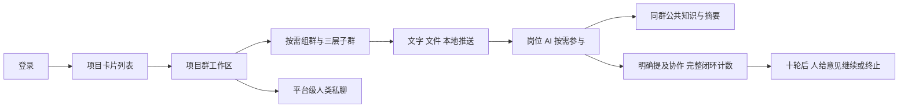

# Judex V2 方案总览与整体确认

> 这是 2026-10-19 的讨论快照。当前正式规则以 [CONTRACTS](CONTRACTS.md) 为准，实施与验收见 [IMPLEMENTATION](IMPLEMENTATION.md)。

更新：2026-10-19。七轮 Q1～Q55 全部回答，当前没有待答的编号产品问题。本文合并有效答复；后续已按用户要求制作 [可交互 UI Demo](PREVIEW.md)，用于核对体验。V2 后端、真实 Agent、清库和服务替换尚未开始。

## 产品主线

Judex V2 以项目管理协作配置，以群承载沟通、文件和共同知识，由人的岗位 AI 按需参与，实际工作在人的本地环境推进。群与最多三层子群替代原计划和任务，工作结果由人自行判断。



## 从用户操作看完整流程

| 阶段 | 已确认行为 |
| --- | --- |
| 登录 | 直接进入项目卡片列表，点击卡片进入该项目的群工作区 |
| 项目配置 | 保留成员邀请、职位模板、项目描述、参考工作流和设置；AI 循环上限在项目配置 |
| 组群 | 从项目成员中选人，填写群目的，按需关联零个或多个工作流，为成员分配本群职位 |
| 多岗与子群 | 一人可在同群兼任多个职位；每群可有多个同级子群，最多根群 → 子群 → 孙群三层 |
| 群聊天 | 发送文字 / 文件，明确区分 @ 人与 @ 岗位 AI；网页未 @ 的普通消息只保存 |
| 本地工作 | 工具读取有权限的指定群上下文；完成本地工作后推送文字 / 文件，可单次只记录 |
| AI 参与 | 普通本地推送唤醒本人全部本群岗位 AI，各自判断职责；其他人的 AI 只有被明确 @ 才唤醒 |
| 阅读文件 | 点击消息附件，在右侧展开内容；默认收起阅读区，关闭后聊天区域变宽 |
| 人判断结果 | 通过消息、文件和实际工作判断进展，不维护任务交付、接收、验收或重开状态链 |
| 群归档 | 已加入目标群的项目 owner / manager 可以归档；父群与全部子孙群一起进入归档列表，仍可讨论 |
| 人类私聊 | 最左侧“聊天”进入平台级私聊；同两人跨项目共用一段对话，文字 / 文件与右侧预览均支持，不参与 AI 调度 |

群目的和流程帮助 AI 理解工作，不变成业务门禁。归档是列表归类，不表示工作完成或冻结群。

## 界面与交互方向

登录后的项目卡片保持清晰的项目选择与管理入口。进入项目后采用参考截图的工作区结构：

```text
应用窄导航 │ 群列表与子群树 │ 当前群聊天            │ 文件内容（按需展开）
群聊       │ 已加入的群     │ 成员 / AI、文字、附件 │ 原文与版本阅读
聊天       │ 归档入口       │ @ 协作与讨论控制卡片  │
           │               │ 底部统一输入框        │
```

视觉实现建议统一减少重复标题和管理后台式表单区域，以消息阅读、输入和文件内容为中心。头像、职位与 AI 标识用于区分参与者，群设置与文件操作通过一致的组件入口展开。

HeroUI 继续作为唯一基础 UI 库，字体、颜色、间距、圆角由统一 token 管理；支持桌面 Web、中英文、浅色 / 深色主题。具体密度、颜色与控件细节由后续交互稿落实，不在本次总览中假装已经完成视觉验收。

## 群、人员与信息边界

- 每个群独立从项目成员中选人，可以只加入子群而不加入父群；层级不赋予其他群读取权。
- 只显示本人已加入的群，不展示未加入父群的名称或目录。新成员可看该群完整历史和仍保留的文件。
- 所有人类群成员可维护群成员、简介、职位及工作流关联，直接拉项目成员入群并通知，无须受邀人接受。
- 归档父群级联全部子孙群，但不因此授予管理员读取未加入子群内容的资格。
- 岗位 AI 可以在本群发言、读文件、发布产物和 @，不自主改群成员 / 设置，也不自主跨群分享。
- 人类私聊独立于项目群；私聊消息和文件不自动供任何岗位 AI 读取。

授权需要覆盖 API、列表、搜索、事件、预览、下载、CLI、Agent 检索和沙箱文件投影。不能只在侧栏隐藏未加入群，或把整个项目文件目录挂给 AI 后靠提示词区分。

## Agent：相同群知识，不同岗位提示词

每份群 + 人 + 职位是一个岗位 AI 身份。采用 Go 执行底座参考 Pi 的 read / bash / edit / write、工具循环与压缩，并增加少量结构化群协作工具。

各岗位组合提示词包括：

`项目描述 + 群目的 + 关联工作流 + 当前职位提示词 + 关联人该职位的个人提示词`

项目描述、群目的和关联工作流是共同背景；职位和个人提示词按身份不同。个人提示词按项目 + 本人 + 职位复用，配置更新后直接使用新版。流程不匹配时由 AI 自行判断，不阻止协作。

同一群的所有 AI 使用共同聊天历史、文件内容、工具取得的本群知识与公共压缩摘要。同一公共快照版本内容一致，不给各岗位分别维护不同的长期业务记忆。

Q54 已确认：工具取得的本群内容和结果自动登记到公共知识，保留作者、来源、版本与可回读引用。其他 Agent 下次被唤醒即可使用；知识更新本身不唤醒其他 Agent。

私人提示词、模型隐藏推理、工具调用是否完成、取消与租约等执行控制数据不复制进公共知识。工具内容共享与各运行保留准确执行记录同时成立，不能因共用知识误判某个岗位已经执行了另一个岗位的操作。

公共摘要按群生成并复用，保留原始记录、各方意见与异议、待回答问题、明确 @、文件依据和覆盖范围。原始历史中的人和 AI 作者均保持明确；跨群内容仍须显式分享。

## 触发、沟通与停止

取消群级“自动辅助 / 仅 @”模式开关，统一按消息来源和明确提及触发（Q53 B）；保留本地单次推送“只记录”的选择。

| 事件 | AI 行为 |
| --- | --- |
| 网页未 @ 的文字 / 文件消息 | 只记录并更新公共上下文 |
| 本地普通推送 | 唤醒提交人全部有效本群岗位 AI，分别判断职责 |
| 本地只记录推送 | 不自动发起 AI 分析 |
| 明确 @ 岗位 AI | 只唤醒指定的本群岗位 |
| 明确 @ 人 | 通知本人，不让其 AI 代答 |
| AI 未 @ 的发言或知识更新 | 保存内容，不唤醒其他 AI |
| 人追加内容 | 并入群历史与当前讨论，后续响应参考新内容，不刷新循环额度 |

岗位 AI 自行选择协作者；平台负责目标核验、持久投递、去重和执行控制。不会再由一个主 AI 独占所有委派与汇总，也不会把本地推送广播给其他人的全部岗位。

等待某人只影响依赖其回答的问题，其他讨论继续。@ 请求、公开意见与结果在群中可见，工具细节收起，不展示模型隐藏推理。

项目上限按完整闭环计数：

- `A → B → A` 是 1 轮。
- `A → B → C → A` 也是 1 轮。
- `A → B → A → B → A` 是 2 轮。
- 同次讨论各分支共享累计 10 轮，换岗位、重试、压缩或追加资料不清零。

达到上限后出现控制卡片。任意人类群成员可填写意见继续、留空继续，或终止本次讨论；通知相关岗位 AI 的关联人，同人多岗去重。终止取消本次运行及待执行往返，之后新的本地推送或明确 @ 仍可发起讨论。

卡片操作、消息、通知和运行记录需可靠持久化，避免并发点击重复续开。它们管理 AI 执行，不承担人的工作完成或验收状态。

## 文件与跨群成果

文件属于群或平台私聊的具体范围。普通同名上传是独立文件，明确更新指定文件才产生新版本。历史消息固定引用发送时版本，群文件列表默认最新，并可切换历史版本。

任意人类群成员可更新或移除群文件，并记录操作者。从群文件列表移除后，历史消息和已经明确分享到其他群的版本仍可读；操作文案说明实际效果。

文件可将指定版本明确分享到本人已加入的目标群；父子群间也可由人显式分享消息、总结或文件。目标群可读被分享的内容，不必加入来源群，也不会获得来源群其他内容或 AI 记忆。

## 重构边界与建议顺序

必须重建群 / 私聊领域、成员授权、群内任职、消息与结构化提及、群公共知识、循环运行控制、文件分享授权和前端路由。旧计划、任务、正式工作报告、交付 / 交接 / 验收与协调者专属委派不能仅换名称继续作为核心。

可保留通用认证、数据库与对象存储基础、模型 Provider、工具日志、沙箱适配、文件转换、HeroUI 与统一组件能力。Go 执行底座的复用不等于保留旧主子 Agent 协作结构。

以下是后续实施设计的建议顺序，不表示已经批准开工：

1. 先做桌面交互稿和统一主题：项目卡片、群工作区、创建群、归档列表、文件阅读 / 版本、私聊及循环卡片。
2. 把已确认规则写成领域 / 授权、数据、API / 事件 / CLI 和 Agent 上下文合同。
3. 建立群成员、任职、消息、文件与私聊底座，再接入共同知识、@ 投递、完整闭环计数与控制卡片。
4. 接入新工作区和本地工具，清理旧领域、接口、页面和失效文档；不保留历史数据兼容层。
5. 进行桌面全流程 E2E、真实模型联测和权限隔离验证，在临时 K8s namespace 执行后清理。

schema 字段、公共快照并发协议、模型预算阈值、配置变更生效边界和控件细节由实施合同明确，不把旧实现默认值当成用户本轮决定。

## 验收范围建议

| 范围 | 需要证明的行为 |
| --- | --- |
| 工作区路径 | 登录项目卡片、进入项目、切群 / 私聊、打开 / 关闭文件阅读区，中英文与深浅主题一致 |
| 群组织 | 多同级子群与三层限制、独立成员、完整历史、只列已加入群、归档父群级联后仍能讨论 |
| 唤醒 | 网页普通消息不启动 AI；本地只唤醒本人全部本群岗位；只记录不启动；@ 人不启动其 AI |
| 共同知识 | 不同岗位接收同版本公共上下文，职位 / 个人提示词正确；工具知识自动共享、压缩后原文可追溯且保留异议 |
| 执行与限额 | 两人 / 多人完整闭环、全分支累计 10 轮、通知对应人、继续 / 终止、并发操作和重试去重 |
| 文件 | 固定历史版本、最新与历史切换、显式分享及移除后旧引用可读、冲突更新不静默覆盖 |
| 信息隔离 | 未加入群及其他私聊不能经 API / 搜索 / 事件 / 预览 / CLI / Agent / 沙箱读取；共享只开放指定内容 |
| 人类私聊 | 跨项目保持同一对话，文字 / 文件可用，服务端不产生 AI 调度 |

这些是未来验收目标，没有声称 V2 已实现或测试通过。当前本地运行的 V1 与已有验收证据保持原时点含义。

## 讨论文档

- [已确认决定](DECISIONS.md)：55 项答复及新决定对旧规则的覆盖。
- [完整讨论记录](DISCUSSION.md)：问题、推荐、原文、事实核查与设计树。
- [产品与工作区草案](DESIGN-DRAFT.md)：产品路径和架构边界。
- [Agent 草案](AGENT-DRAFT.md)：共同知识、提示词、工具、投递与压缩细化。

可结合 [Demo](PREVIEW.md) 核对本总览与实际操作是否准确表达整体意图，再形成后续实施合同。当前授权包含独立 UI Demo，不包含后端领域重构、清库或替换部署。
